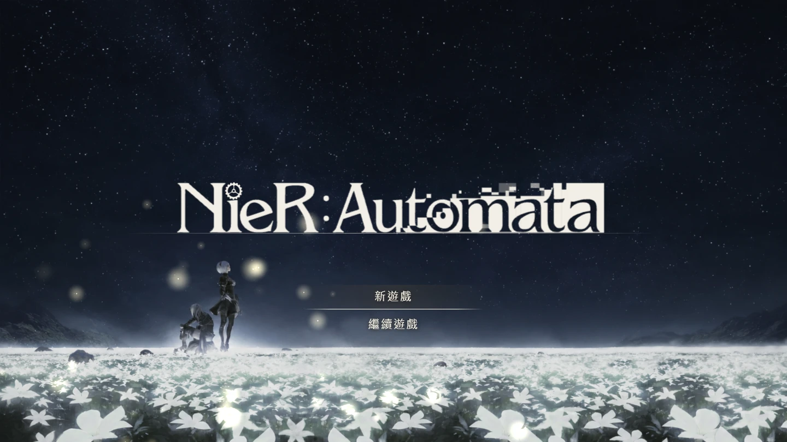

# NieR:Automata · [E] 结局网页版

制作人员名单滚过屏幕，Pod 042 决定抢救即将被删除的数据。你接手一架小飞机，穿过弹幕，逐行击破名单上的职称和姓名。这款浏览器射击游戏以《NieR:Automata》的 E 结局为原型，支持键鼠和手柄。

[本地运行](#本地运行) · [开发者选关](#跳到指定关卡) · [早期版本在线试玩](https://nier-mini-game.vercel.app/zh-hk)



## 本地运行

本地开发使用 Node.js 22 和 pnpm。已有源码时，在网页版仓库根目录从 `pnpm install` 开始。

```sh
git clone https://github.com/syby119/nier-mini-game.git
cd nier-mini-game
pnpm install
pnpm dev
```

打开[本地游戏首页](http://localhost:3000/zh-hk)。界面使用繁体中文。图片、模型、字体和音频都随仓库提供，位于 [public/](public/)。

Pod 042 和 Pod 153 默认在中国大陆、港澳台及日本使用日语配音，其他地区使用英语。服务端未提供地区时，游戏会读取浏览器的首选语言和地区。也可以手动选择整局使用的配音。[日语](http://localhost:3000/zh-hk?voice=ja) · [英语](http://localhost:3000/zh-hk?voice=en)

## 开始游戏

- **「新遊戲」**　输入玩家名创建存档。制作人员名单开始滚动，跟随 Pod 对话做出选择，名单倒放后进入射击。
- **「繼續遊戲」**　选择已有存档，点击「開始射擊」，直接从第一波 `DIRECTOR` 开始新的一局。
- **战斗中重试**　被击毁后选择继续，会从当前制作名单段落的检查点重新开打。

每个存档都保存在当前浏览器里。选档时可以查看游玩局数、通关次数、最高分、累计击破数、游玩时长和每局记录。战斗中每五秒保存一次统计，切走标签页或离开页面时也会保存，中途退出的对局同样计入历史。

| 战斗操作 | 键盘和鼠标 | 手柄 |
| --- | --- | --- |
| 移动 | W / A / S / D | 左摇杆 |
| 瞄准 | 按住鼠标左键，移动指针 | 右摇杆 |
| 连续射击 | 按住左键瞄准后，再按住右键 | 按住 RB / R1 |
| 暂停或恢复 | Esc | Start / Options |

<details>
<summary>援护与通关后的存档（含结局内容）</summary>

多次被击毁后，可以接受其他玩家的援护。乐曲从独唱转入合唱，支援机围绕本机列阵齐射。本机中弹时会损失一架支援机，随后有新的飞机补位。

通关后可以给下一位玩家留言，也可以选择捐出这份存档。确认捐出且上传成功后，游戏会从当前浏览器移除这份存档及其游玩记录。

</details>

## 开发与调试

游戏使用 Next.js、TypeScript 和 React Three Fiber。Three.js 渲染场景，Rapier 处理碰撞，Zustand 管理游戏状态。

### 跳到指定关卡

用 `pnpm dev` 启动后，按 **F2** 或点击右下角的「選關」即可按制作人员名称或关卡编号选择起点。也可以收藏下列本地地址，直接复现对应场景。

| 场景 | 本地入口 |
| --- | --- |
| 第一波，导演字幕 | [DIRECTOR](http://localhost:3000/zh-hk?stage=0) |
| 概念美术段落 | [CONCEPT ART](http://localhost:3000/zh-hk?stage=10_1) |
| 最终战，带支援编队和合唱 | [Yosuke Matsuda](http://localhost:3000/zh-hk?stage=final&support=1) |
| 通关后的成绩画面 | [结算](http://localhost:3000/zh-hk?stage=end) |

### 从哪里改

| 要修改的内容 | 代码入口 |
| --- | --- |
| 游戏入口、场景与界面组装 | [页面入口](src/app/%5Blocale%5D/page.tsx)、[GameCanvas.tsx](src/game/GameCanvas.tsx)、[GameOverlays.tsx](src/game/GameOverlays.tsx) |
| 封面、滚动与倒放的制作名单 | [cover/](src/features/cover/)、[opening/](src/features/opening/) |
| 飞机、弹幕、字幕敌人与检查点 | [combat/](src/features/combat/)、[波次配置](src/features/combat/enemies/waves/) |
| 音乐循环、合唱切换与 Pod 配音 | [audio/](src/features/audio/) |
| 游玩记录、死亡重试与结局 | [对局生命周期](src/game/battleSession.ts)、[saves/](src/features/saves/)、[rescue/](src/features/rescue/)、[ending/](src/features/ending/) |
| 排行榜、留言与存档上传 | [community/](src/features/community/)、[API 路由](src/pages/api/)、[服务端存储](src/server/playerSaves.ts) |

### 社区数据

本地开发默认将排行榜、留言和捐档数据写入服务端的 `.nier-saves/`。要用 MongoDB 验证这些功能，在仓库根目录的 `.env.local` 中填写连接地址，然后重启开发服务。游戏会使用 `nier` 数据库的 `player` 集合。

```dotenv
MONGODB_URI=mongodb://127.0.0.1:27017/nier
```

### 检查与构建

```sh
pnpm format
pnpm format:check
pnpm typecheck
pnpm build
```

构建完成后，运行 `pnpm exec next start` 可在本地预览生产版本。

## 来源与许可

项目始于一次 React Three Fiber 学习练习，部分粒子效果和游戏逻辑由 ChatGPT 辅助实现。图形实现参考了 Wawa Sensei 的教程和 Drei 的示例。[Drei 示例](https://github.com/pmndrs/drei) · [早期战斗截图](git_image/demo1.png)

部分音效取自 Mugen87 的 NieR 项目，Pod 的日语对白取自玩家整理的原作录音。[Mugen87/nier](https://github.com/Mugen87/nier) · [日语音频档案](https://steamcommunity.com/groups/nierMnM/discussions/2/135512625246228407/?ctp=4)

项目代码采用 [MIT 许可证](LICENSE)。
